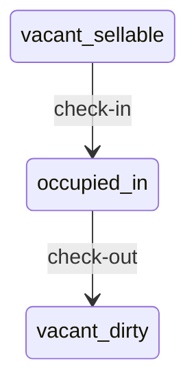

# Coding Style Guide

This document defines the coding conventions for the DNIe Hotel Check-in project. All contributors must follow these rules.

## Variable and Function Naming

### Case Styles

| Element | Style | Example |
|---------|-------|---------|
| Variables | `snake_case` | `my_foo_var` |
| Functions | `snake_case` | `read_dnie()` |
| Classes | `Pascal_snake_case` | `class Foo_name` |
| Constants | `UPPER_SNAKE_CASE` | `_ENCODING_X509_ASN` |
| Private members | Leading underscore | `_is_verbose` |

### Example

```python
class Dni_reader:
    def __init__(self, verbose: bool = True):
        self._is_verbose = verbose
        self._last_successful_fingerprint = ""

    def read_dnie(self) -> Tuple[Dni_read_status, Optional[Dni_data]]:
        pass
```

## Boolean Naming

Booleans must be named as **yes/no questions**:

```python
is_empty
is_not_red
is_repeating
is_duplicate
is_connected
is_reading
is_stopped
```

## Error Handling

Be **verbose when something fails**. Every error should explain:
- What went wrong
- Why it might have happened
- What the user/developer can do about it

```python
if not store_handle:
    err = ctypes.GetLastError()
    raise RuntimeError(
        f"Failed to open certificate store '{store_name}'. "
        f"Windows error code: {err}. "
        "Possible causes: cryptographic services not running, "
        "or the certificate store is corrupted."
    )
```

## Constants and Enums

If a set of related constants shares the same type, use an **Enum**:

```python
class Dni_read_status(Enum):
    SUCCESS = "success"
    DUPLICATE = "duplicate"
    NO_CARD = "no_card"
    ERROR = "error"
    STORE_ACCESS_ERROR = "store_access_error"
    NO_MIDDLEWARE = "no_middleware"
    INCOMPLETE_PAIR = "incomplete_pair"
```

## JavaScript

- Use `"use strict";` always
- Same naming conventions: `snake_case` for variables/functions, `Pascal_snake_case` for classes

```javascript
"use strict";

function hotel_checkin_app() {
    return {
        is_connected: false,
        dragged_id: null,

        _connect_sse() {
            // …
        }
    };
}
```

## HTML/CSS

- Use **modern HTML5 semantic tags**: `<header>`, `<main>`, `<footer>`, `<section>`, `<article>`, `<aside>`, `<nav>`
- Use **modern CSS**: CSS custom properties (variables), flexbox, grid, `clamp()`, `calc()`
- Avoid floats for layout
- Prefer CSS transitions over JavaScript animations where possible

```html
<body>
    <header class="app-header">…</header>
    <main class="app-main">
        <section id="hotel_overview_section">…</section>
        <section id="guest_management_panel">…</section>
    </main>
    <footer class="app-footer">…</footer>
</body>
```

## Python Specifics

- Type hints on function signatures
- Docstrings on all public methods
- `from typing import …` for complex types
- `dataclasses` for data containers
- `threading.Lock` for shared state protection

## File Organization

- One class per file if the class is large (>300 lines)
- Group related functions together
- Imports at the top, grouped: stdlib, third-party, local

## Documentation

These rules apply to every document in the repository (`README.md`,
`ARCHITECTURE.md`, `DATA_SCHEMA.md`, `HANDOFF.md`, `ROADMAP.md`, reports,
change requests) and to docstrings/comments that contain diagrams.

- **All documentation is written in Markdown** (`.md`). No `.txt`, `.docx`
  or HTML documents in the repository.
- **Never draw ASCII diagrams** (box-and-arrow art, `-->` flows drawn with
  characters, `├──` trees). Always use a **Mermaid** code block instead:
  `flowchart` for architecture and flows, `sequenceDiagram` for
  request/thread interactions, `stateDiagram-v2` for state machines,
  `erDiagram` for database relations.
- Directory layouts are written as a Markdown **table** (`Path | Purpose`),
  not as a tree.
- Keep diagrams next to the text they explain and update them in the same
  commit as the code they describe.

````markdown

````
