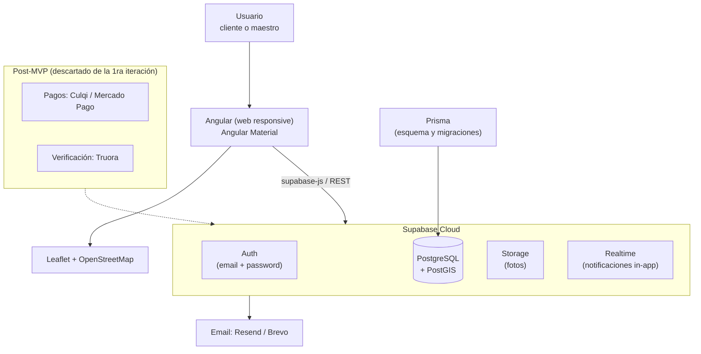

# Tech Stack — MVP Marketplace de Servicios para el Hogar

> Documento consolidado y definitivo. Integra las sugerencias iniciales, la propuesta
> alternativa revisada y las decisiones del equipo de desarrollo.
>
> **Objetivo del MVP:** validar el negocio lo más rápido posible — que un hogar publique
> una solicitud, un maestro cotice, el cliente acepte, el servicio se complete y ambos
> se califiquen.

---

## 1. Decisiones tomadas (contexto)

| Decisión | Resultado |
|---|---|
| Objetivo | **Validar el negocio lo más rápido posible** (no demostrar infraestructura) |
| Plataforma | **Web only** (responsive). Sin app móvil, sin PWA por ahora |
| Backend | **Supabase** (BaaS). NestJS descartado para este MVP |
| Autenticación | **Naive**: correo + contraseña, confiando en los usuarios |
| Pagos | ⏸️ Descartados de la primera iteración (pago coordinado fuera de la app) |
| Verificación de identidad | ⏸️ Descartada (se asume que todo maestro registrado es de confianza) |
| Módulo de administrador | ⏸️ Postergado. Operación manual desde Supabase Studio |
| Adquisición | **Doble landing estilo Booking**: una para clientes y otra para maestros ("Regístrate como maestro") |
| Multimedia | **Solo fotos**; videos en iteraciones finales tras validar |
| Red de confianza | Simplificada: **solo agregados por zona** ("3 personas de tu zona contrataron a Pedro") |
| ORM / esquema de BD | **Prisma** sobre el PostgreSQL de Supabase |

---

## 2. Stack final

| Capa | Tecnología | Notas |
|---|---|---|
| Lenguaje | **TypeScript** (full stack) | Tipado de punta a punta |
| Frontend | **Angular** (standalone components + signals) | Web responsive |
| UI | **Angular Material** (+ Tailwind opcional) | Componentes listos, sin diseñador |
| Backend / BaaS | **Supabase** | PostgreSQL + Auth + Storage + API + Realtime |
| Base de datos | **PostgreSQL + PostGIS** (en Supabase) | Relacional + consultas por distancia |
| ORM / migraciones | **Prisma** | Esquema versionado, type-safe, buena asistencia de IA |
| Auth | **Supabase Auth** (email + password, sin verificación) | Naive a propósito para el piloto |
| Storage | **Supabase Storage** | Solo imágenes (solicitudes, perfiles, portafolio) |
| Mapas | **Leaflet + OpenStreetMap** | Gratis, sin API keys de pago |
| Matching | Consultas SQL/PostGIS + `ORDER BY` reputación | **Sin ML** |
| Notificaciones | Internas (tabla) + email (**Resend** o **Brevo**) | Sin push, sin chat |
| Despliegue frontend | **Vercel** (plan gratuito) | Build estático de Angular |
| Backend/BD | **Supabase Cloud** (plan gratuito) | Incluye Studio para operación manual |
| Dominio | Cloudflare Registrar / Namecheap | ~USD 10/año |
| Analítica | **PostHog** (free tier) | Validar embudos del piloto |
| Errores | **Sentry** (free tier) | |
| Control de versiones | Git + GitHub | Ramas `main` / `develop` / `feature/*` |
| Diseño | Figma | Mockups antes de codificar |
| Testing de API | Postman | Probar endpoints y webhooks |
| Desarrollo asistido | Cursor / Copilot | Ver sección 6 |

**Costo estimado del MVP: USD 0–15/mes** (básicamente el dominio).

---

## 3. Arquitectura general

---

## 4. Alcance funcional del primer MVP

**Incluye:** landings duales (clientes/maestros), registro naive, perfiles, solicitudes
con fotos y ubicación, matching por especialidad/zona/disponibilidad ordenado por
reputación, cotizaciones con versionado (PENDING/ACCEPTED/REJECTED/SUPERSEDED),
máquina de estados del servicio (REQUESTED→QUOTED→ACCEPTED→COMPLETED, CANCELLED/
DISPUTED), calificación bilateral tras COMPLETED, reputación, historial y
"Volver a contratar", incidencias simples (OPEN/IN_REVIEW/RESOLVED/CLOSED),
notificaciones internas + email.

**No incluye (postergado):** pagos, verificación de identidad, panel de administrador,
videos, grafo social personal ("Rosa recomienda a Pedro"), push notifications, chat en
tiempo real, PWA, planes B2B.

Detalle de módulos en `MODULES.md` y fases en `ROADMAP.md`.

---

## 5. Riesgos técnicos y mitigaciones

1. **Auth naive = riesgo asumido.** Sin verificación de correo ni identidad. Aceptable
   con 10–20 maestros reclutados a mano; agregar verificación de email ante el primer
   signo de spam o suplantación.
2. **Sin panel admin,** el equipo opera directo desde Supabase Studio. Si las
   incidencias superan ~2 por semana, adelantar el módulo.
3. **Dependencia de Supabase:** mitigable — la BD es PostgreSQL estándar, exportable y
   migrable a un backend propio (NestJS) si el producto escala.
4. **Realtime:** el realtime de Supabase es suficiente para el MVP; no montar WebSockets
   propios.
5. **PostGIS en Supabase** viene incluido; validar cobertura de OSM/Leaflet en la zona
   del piloto (Arequipa).
6. **Pagos futuros:** la custodia de fondos puede tener implicancias regulatorias en
   Perú — validar con la pasarela antes de implementar (Fase 3).

---

## 6. Compatibilidad con desarrollo asistido por LLMs

El stack elegido es de los más "LLM-friendly" disponibles:

- **Angular + TypeScript + Angular Material:** amplísima representación en datos de
  entrenamiento y documentación oficial de calidad; la estructura opinionada de Angular
  hace que el código generado sea consistente.
- **Supabase + PostgreSQL:** documentación excelente (incluye `llms.txt`) y miles de
  ejemplos públicos.
- **Prisma:** mucho mejor cubierto por los LLMs que TypeORM (más ejemplos modernos,
  menos errores generados).
- **Zonas de supervisión humana estricta:** integraciones con documentación delgada y
  pocos ejemplos — **Culqi/Mercado Pago** y **Truora** (los LLMs alucinan endpoints).
  Están fuera del primer MVP; al integrarlas, usar SDK oficial y pegar la documentación
  en el contexto del asistente.

---

## 7. Tecnologías explícitamente fuera del MVP

NestJS (backend propio), apps móviles nativas, PWA, push notifications, WebSockets
propios, Redis, Docker/Kubernetes, microservicios, CI/CD complejo, monitoreo con
Grafana, Neo4j, ML para matching, escrow/custodia de fondos, KYC automatizado, chat en
tiempo real, sistema de tickets complejo.

> **Principio rector:** implementar únicamente lo necesario para validar el flujo
> solicitud → cotización → aceptación → servicio → calificación. Todo lo demás se
> activa con evidencia del piloto.
